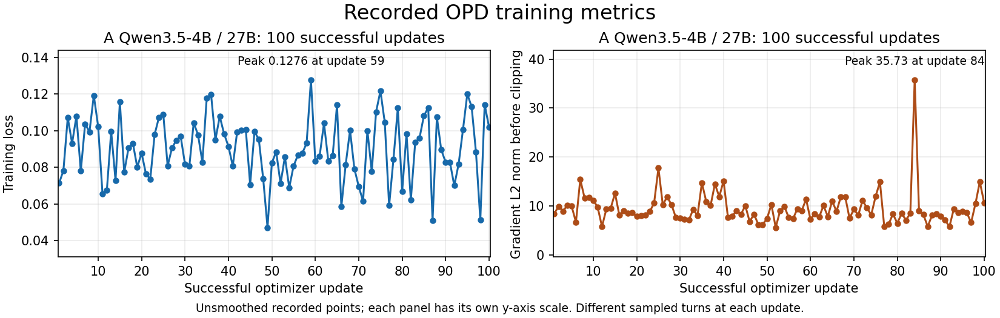

## Modification History

| Date | Change |
| --- | --- |
| 2026-11-07 | Link parent's subsequent independent final-HF PASS and clarify raw-token audit as an unperformed scope limit. |
| 2026-11-07 | Extract all 100 actual A updates, bind native counters/publications, render unchanged plotting code, and summarize fixed monitoring with explicit evidence limits. |

# A: actual training and fixed-monitor curves

Task ID: `QWEN-P3-A-TRAINING-CURVES`.

**Result:** the settled H200 run `exp-1107-173758-712234`, Qwen3.5-4B student / frozen Qwen3.5-27B teacher, has **100 successful updates / 0 skipped**, complete every-step signed loss, positive pre-clipping gradient norm and two optimizer-group LR records, and six passing same-version monitoring checkpoints. The late window has slightly higher mean loss and gradient norm than the early window. Fixed-monitor sampled teacher/student gaps are lower at final than baseline but fluctuate. **Convergence and capability improvement are not demonstrated within this budget.** Final HF reload remains independently parent-owned.

## Artifacts and source boundary

- [A-training-steps.json](evidence/A-training-steps.json): every recorded training, rollout, generation-performance and training-performance scalar dictionary; raw stdout line references; native successful-step/group/publication evidence; resolved native config; all 100 points; window statistics; six monitoring summaries.
- [A-training-steps.md](evidence/A-training-steps.md): full-precision 100-point loss/gradient table in the existing plot parser's format.
- [A-training-curves.png](evidence/A-training-curves.png): unsmoothed actual loss and pre-clipping gradient-norm panels, rendered by unchanged `tests/manual/agent_opd/plot_training_metrics.py`.



Numerical/counter source: [completion-inspection-A-exp-1107-173758-712234-2132.json](evidence/completion-inspection-A-exp-1107-173758-712234-2132.json). Settled raw stdout supplied by parent: `/data/ycfeng/tmp/opencode-v2-tmp/opencode/A-exp-1107-173758-712234-complete.log`, 20,073,306 bytes. Native launch provenance: [launch.json](evidence/first-round/student/A/exp-1107-173758-712234/launch.json), source commit `e3d626553bf1887c73c0423fb0f4905a1064cd13`, recorded worker Python 3.12.16. The launch and [training.json](evidence/first-round/student/A/exp-1107-173758-712234/training.json) alone are not update-count or final-HF qualification.

Criteria: [requirements.md](requirements.md), D8/D9/D12/D14/D18, and [design.md](design.md), numerical acceptance and first training-effectiveness budget. This analysis reads only existing local sources and artifacts; it does not access cloud paths or execute training/model inference.

## Every-step coverage and metric meaning

| Evidence | Actual result | Interpretation |
| --- | --- | --- |
| Recorded scalar coverage | Train, rollout, generation-performance and training-performance dictionaries cover stdout steps 0–99 exactly. Each train dictionary is logged twice with identical values; duplicates are retained as line references, not plotted twice. | 100 original scalar points, no filled/interpolated updates. |
| Native successful-update coverage | 100 publication receipts, rollout IDs 0–99, candidate/published versions 1–100, successful optimizer-counter delta 1 each; 100 matching native stdout publication IDs. | Successful update = stdout step + 1 only after the native counter/publication checks. |
| Native step outcomes | Each rollout has one actor attempt-0 group-end receipt with eight NORMAL rank outcomes and matching valid-step records. | NORMAL alone is not used to establish optimizer success. |
| Consumed versions | All eight generated training completions per rollout record decode/prefill consumed version equal to rollout ID, with zero mixed-version ratios. | Initial training uses version 0; final accepted publication is version 100. |
| LR | Both `train/lr-pg_0` and `train/lr-pg_1` equal `2e-6` on all 100 updates. | Recorded native LR, not an assumed launcher default. |
| Signed loss | First 0.0713067371; last 0.1019779587; min 0.0471496865 at update 49; max 0.1276463572 at update 59. | Recorded signed policy objective. All A values happen to be positive; no absolute-value conversion or sign restriction is applied. |
| Pre-clipping gradient norm | First 8.38544750; last 10.59483147; min 5.56097841 at update 52; max 35.73197556 at update 84. | Finite positive global gradient L2 norm before clipping, not parameter-update norm. |
| PPO clipping | Recorded `train/pg_clipfrac = 0` on all 100 updates. | PPO objective clipping, not gradient clipping. |
| Gradient clipping | Resolved `clip_grad = 1.0`, stdout line 195; all 100 pre-clipping norms exceed it. | Threshold comparison and clipping activity are **inferred from the native contract**. No actual clipping coefficient, post-clipping norm or gradient-clipping fraction is logged. |
| Training TIS | Native low-mask fraction is nonzero only at successful update 91: `0.0002955082742316785`; high-mask fraction is zero throughout. | Retain the native aggregation as recorded; do not turn it into an exact globally retained-token count or say training retention is 100%. |
| Generated completion counts/lengths | Eight recorded training completions per rollout, 800 total; 237,618 generated response tokens and 67,089,977 combined prefix/response tokens. | Totals are **derived** from recorded mean lengths × actual sample count, checked to be integral; they are not original loss-target or post-TIS survivor denominators. |

Source contracts inspected locally:

- `miles/backends/training_utils/metrics/log_utils.py:520–575` explicitly identifies `grad_norm` as pre-clipping L2 norm. `miles/backends/megatron_utils/model.py:677–681` passes `optimizer.step()`'s norm and increments the model-companion counter only after success. The current scalar logger/reduction does not independently reproduce raw distributed arithmetic.
- `miles/backends/training_utils/loss/hub/losses.py:304–317,371–377` constructs/reports the signed policy objective; `train/loss == train/pg_loss` and recorded entropy loss is zero on every A step. `loss/hub/math_utils.py:255–278` defines PPO objective clipping. Neither quantity is an exact teacher/student KL or capability score.
- Resolved `calculate_per_token_loss=True` is recorded at stdout line 143. `loss/objective.py:129–131,173–184` owns original-mask counting, including the native count-of-one convention for fully masked samples; `metrics/log_utils.py:466–517` owns scalar reduction. A scalar extraction cannot independently qualify the original-token global gradient denominator.
- `metrics/log_utils.py:255–269` logs non-tensor lengths using sum/count. The trainer's response-length mean matches recorded generation mean at every update; generation lengths, rewards, truncation, version and all TIS scalar metrics are retained in the JSON without redefining their population.

## Early/late windows and assessment

Windows are **successful updates 1–20 and 81–100**, 20 updates each, fixed for this retrospective assessment to match monitoring cadence. They were not registered before training. Means give each update equal weight; they are not pooled token-weighted means. Standard deviations below describe these different sampled turns, not confidence intervals.

| Metric | Early 1–20 | Late 81–100 | Late minus early |
| --- | --- | --- | --- |
| Loss mean | 0.090480453 | 0.091233265 | +0.000752812 (+0.832%) |
| Loss median | 0.091839265 | 0.094752558 | +0.002913293 |
| Loss sample SD | 0.016148593 | 0.020348875 | +0.004200283 |
| Loss min–max | 0.065603936–0.119151105 | 0.050845090–0.119993715 | Overlapping ranges |
| Pre-clipping norm mean | 9.62460036 | 9.88970551 | +0.26510515 (+2.754%) |
| Pre-clipping norm median | 9.40486813 | 8.47493458 | −0.92993355 |
| Pre-clipping norm sample SD | 2.13627379 | 6.39465818 | +4.25838439 |
| Pre-clipping norm min–max | 5.74119711–15.38107014 | 5.73339558–35.73197556 | Overlapping ranges; late outlier at update 84 |
| Generated response tokens, 160 completions/window | 49,453 | 51,215 | +1,762 |
| Mean response tokens/completion | 309.08125 | 320.09375 | +11.0125 |
| Mean combined prefix/response tokens/completion | 84,911.9 | 83,971.11875 | −940.78125 |

**Assessment:** the settled curves fluctuate; late mean loss and norm are slightly higher, while median norm is lower and late norm variability is larger. Different shuffled prefixes and fresh completions/token mixtures are used at successive updates. Actual successful publications, finite losses and nonzero gradients establish that optimization occurred. They do not demonstrate convergence, beneficial parameter-update magnitude or capability improvement. No tuning, smoothing, budget extension or new experiment is used to change that outcome.

## Six-point fixed-monitor diagnostics

Each checkpoint freshly samples from the same 24 held-out prefixes: eight in each frozen short/medium/long stratum `(0,32768]`, `(32768,65536]`, `(65536,122880]`. All six required positions exist; consumed versions are 0/20/40/60/80/100, with inspector rollout IDs 0/19/39/59/79/99. There are **144 actual monitoring completions and 31,027 original eligible completion tokens**. These repeated measurements do not constitute 144 independent prefixes.

Teacher/student metrics use `d = log p_teacher - log q_student_decode`, `r = exp(d)`, `A = r*d-r+1` (teacher-to-student directional form), and `B = r-1-d` (student-to-teacher directional form), under student sampling at temperature 1 / top-p 1 / top-k −1. They are finite sampled-token averages, not exact full-vocabulary KL measurements. Same-student D8 instead compares trainer with decode or same-token prefill under the same consumed student weight version.

| Updates/version | Original tokens | Teacher/student token-weighted mean `|d|` | Mean A / B | Equal-prefix mean `|d|` | D8 decode / prefill mean absolute error | Monitoring TIS retained |
| --- | --- | --- | --- | --- | --- | --- |
| 0 | 4,662 | 0.262118 | 0.180803 /0.149184 | 0.242244 | 0.011471 /0.011311 | 4,662/4,662 |
| 20 | 5,449 | 0.166071 | 0.115218 /0.087019 | 0.171231 | 0.007347 /0.007843 | 5,449/5,449 |
| 40 | 4,396 | 0.199461 | 0.167516 /0.111528 | 0.194249 | 0.008718 /0.008740 | 4,396/4,396 |
| 60 | 5,503 | 0.198623 | 0.131593 /0.104169 | 0.195069 | 0.008377 /0.008430 | 5,503/5,503 |
| 80 | 5,820 | 0.173908 | 0.094234 /0.086637 | 0.188288 | 0.007464 /0.007653 | 5,820/5,820 |
| 100 | 5,197 | 0.201468 | 0.090738 /0.094886 | 0.204598 | 0.008663 /0.008466 | 5,197/5,197 |

Teacher/student short/medium/long absolute-gap means are retained separately in the JSON; neither that cross-model gap nor training's filtered mismatch scalar replaces D8. All checkpoints' D8 overall and three length strata pass the unchanged **0.03 pre-TIS mean threshold**. All expected monitoring tokens are finite in decode, prefill and teacher comparisons; missing/nonfinite values, unknown denominators and zero-target samples are all zero. Tails, unclamped K3 forms and reported token coordinates remain available in the original inspector; the derived JSON preserves all per-stratum scalar summaries without recomputing unavailable raw-token quantiles.

Baseline→final, 19/24 matched prefixes have lower sampled absolute gaps and 5 have higher gaps; equal-prefix mean paired change is −0.037645733. Token-weighted gap decreases 0.262118→0.201468, but rises after update 20 and again at final. Different fresh completions and lengths change the token mixture; one completion per prefix/checkpoint provides no repeated-sampling or group-aware confidence interval. Learning significance and capability improvement remain unproven.

Monitoring TIS uses student-train/student-decode ratios, inclusive `[0.5,2]`, not teacher/student ratios. Monitoring retention is 100% at each point, separately from the nonzero training low-mask metric at update 91. The inspector JSON contains only worst-token subsets, not a complete ratio distribution, so exact monitoring ratio quantiles/min/max are not reconstructed. Teacher probability semantics and identity are source/startup/launch-contract-derived, not per-response request/revision/teacher-weight-version receipts; this limitation is preserved in the derived artifact.

## Missing metrics and exact parent follow-up

No required loss/gradient/LR/native-counter point is missing. **Exact per-step original eligible-target and post-TIS survivor counts are not separately logged**, and there is no logged gradient-clipping coefficient/postclip norm or parameter-update norm. These quantities are not synthesized from generation lengths, PPO clipping or native reduced TIS fractions.

If exact target/retained counts are needed, parent should retrieve the existing A artifacts for accepted rollout IDs `i=0..99` under:

`/mnt/codesign-exp/ycfeng/miles-qwen35-three-pairs/first-round/student/A/exp-1107-173758-712234/`

- `rollout_data/{i}.pt`: `samples[*].tokens`, `response_length`, `loss_mask`, `weight_versions` and native scoring/version metadata.
- `train_data/{i}_{rank}.pt`: `rollout_data.tokens`, `loss_masks`, `rollout_mask_sums`, `log_probs`, `rollout_log_probs`, `response_lengths`, `total_lengths`, `sample_indices`, with `cp_rank/cp_size/qkv_format`; unique TP-source ranks are 0/2/4/6 for the recorded TP2/CP1 student layout.

Resolved output templates are stdout lines 1223–1224. Payload owners are `miles/ray/rollout/debug_data.py:117–149` and `miles/backends/training_utils/metrics/train_dump.py:11–47`. Parent must check actual payload availability and masks/probability roles before applying the declared TIS predicate. This report does not download or inspect those raw tensors; final HF qualification is not duplicated.

## Exact local extraction and plotting command

Environment: `/data/ycfeng/sota-engine/miles`, system `/usr/bin/python3` 3.10.6 (GCC 11.3.0), Matplotlib 3.7.1, CPU/Agg; no conda environment, Torch or model runtime load. Only the three named generated evidence files and this English report are persistent deliverables. The plotter and shared documents are unchanged.

The command below independently parses A stdout, checks every native counter/publication, preserves original scalar dictionaries, writes the parser-compatible table, and invokes the **existing plotter**. Assertions are direct extraction/artifact checks; no test suite is launched.

```bash
env PYTHONDONTWRITEBYTECODE=1 TMPDIR=/data/ycfeng/tmp/opencode-v2-tmp/opencode MPLCONFIGDIR=/data/ycfeng/tmp/opencode-v2-tmp/opencode/qwen35-plot-cache python3 -B - <<'PY'
import ast, collections, json, math, re, shlex, statistics, subprocess, sys
from pathlib import Path
root = Path('task_memory/task_2026-11-06_qwen35_three_pairs')
raw = Path('/data/ycfeng/tmp/opencode-v2-tmp/opencode/A-exp-1107-173758-712234-complete.log')
inspection = root / 'evidence/completion-inspection-A-exp-1107-173758-712234-2132.json'
launch_path = root / 'evidence/first-round/student/A/exp-1107-173758-712234/launch.json'
lines = raw.read_text().splitlines()
buckets = collections.defaultdict(lambda: collections.defaultdict(list))
events = collections.defaultdict(lambda: collections.defaultdict(list))
valid = collections.defaultdict(list)
config = {}
config_names = {'clip_grad', 'calculate_per_token_loss', 'log_probs_backend', 'true_on_policy_mode',
                'use_rollout_logprobs', 'use_tis', 'use_rs', 'tis_level', 'tis_mode',
                'tis_lower_bound', 'tis_upper_bound', 'tis_batch_normalize',
                'save_debug_rollout_data', 'save_debug_train_data'}
for number, original in enumerate(lines, 1):
    line = re.sub(r'\x1b\[[0-9;]*m', '', original)
    match = re.search(r' - (step|rollout|perf) (\d+): (\{.*\})$', line)
    if match:
        kind, step, literal = match.groups()
        metrics = ast.literal_eval(literal)
        if kind == 'step':
            if 'train/loss' not in metrics:
                continue
            kind = 'train'
        elif kind == 'perf':
            kind = 'rollout_perf' if 'rollout/num_training_samples' in metrics else 'train_perf'
        buckets[kind][int(step)].append((number, metrics))
    if 'audit op=event event=' in line:
        fields = dict(token.split('=', 1) for token in shlex.split(line.split('audit ', 1)[1]) if '=' in token)
        kind = fields['event']
        if kind in ('WeightUpdateResultEvent', 'TrainGroupStepEndEvent') and fields.get('rollout_id', '').isdigit():
            events[kind][int(fields['rollout_id'])].append((number, fields))
    match = re.search(r'train op=train_step rollout=(\d+) step=0 attempt=0 outcome=(\w+) valid_step=(\w+)', line)
    if match:
        valid[int(match[1])].append((number, match[2], match[3]))
    match = re.match(r'\s+(\w+)\s+\.+\s+(\S+)\s*$', line)
    if match and match[1] in config_names:
        config[match[1]] = {'raw_value': match[2], 'stdout_line': number}
assert config['clip_grad']['raw_value'] == '1.0'
assert config['calculate_per_token_loss']['raw_value'] == 'True'
d = json.loads(inspection.read_text())
w = d['weight_publication']
assert d['verdict'] == w['verdict'] == 'PASS' and not d['issues'] and not w['issues']
assert (w['successful_optimizer_updates'], w['skipped_optimizer_updates'],
        w['baseline_weight_version'], w['final_published_weight_version']) == (100, 0, 0, 100)
assert len(w['publications']) == 100
for kind in ('train', 'rollout', 'rollout_perf', 'train_perf'):
    assert sorted(buckets[kind]) == list(range(100)), kind
for kind in ('WeightUpdateResultEvent', 'TrainGroupStepEndEvent'):
    assert sorted(events[kind]) == list(range(100)), kind
assert sorted(valid) == list(range(100))
steps = []
for step, publication in enumerate(w['publications']):
    row = {'successful_update': step + 1, 'rollout_id': step, 'stdout_lines': {}, 'native_events': {}}
    for kind in ('train', 'rollout', 'rollout_perf', 'train_perf'):
        records = buckets[kind][step]
        assert len(records) == (2 if kind == 'train' else 1), (kind, step)
        assert all(record[1] == records[0][1] for record in records)
        assert all(isinstance(v, (int, float)) and math.isfinite(v) for v in records[0][1].values())
        row[kind] = records[0][1]
        row['stdout_lines'][kind] = [record[0] for record in records]
    train, rollout, generation = row['train'], row['rollout'], row['rollout_perf']
    assert train['train/step'] == train['rollout/step'] == step
    assert train['train/loss'] == train['train/pg_loss'] and train['train/entropy_loss'] == 0
    assert train['train/grad_norm'] > 0
    assert train['train/lr-pg_0'] == train['train/lr-pg_1'] == 2e-6
    assert generation['rollout/num_training_samples'] == 8
    assert rollout['rollout/response_lengths'] == generation['rollout/response_len/mean']
    for suffix in ('', 'prefill_'):
        assert generation[f'rollout/weight_version/{suffix}min'] == generation[f'rollout/weight_version/{suffix}max'] == step
        assert generation[f'rollout/weight_version/{suffix}mixed_version_ratio'] == 0
    assert len(valid[step]) == 2 and all(outcome == 'NORMAL' and flag == 'true' for _, outcome, flag in valid[step])
    row['stdout_lines']['valid_step'] = [record[0] for record in valid[step]]
    row['native_valid_step_records'] = [{'line': n, 'outcome': outcome, 'valid_step': flag} for n, outcome, flag in valid[step]]
    row['publication'] = publication
    assert (publication['rollout_id'], publication['candidate_version'],
            publication['published_version'], publication['optimizer_counter_delta']) == (step, step + 1, step + 1, 1)
    for kind in ('WeightUpdateResultEvent', 'TrainGroupStepEndEvent'):
        assert len(events[kind][step]) == 1
        number, fields = events[kind][step][0]
        row['stdout_lines'][kind] = [number]
        row['native_events'][kind] = fields
        if kind == 'WeightUpdateResultEvent':
            assert int(fields['candidate_version']) == int(fields['published_version']) == step + 1
            assert fields['debug_weight_update_id'] == publication['debug_weight_update_id']
            assert not fields['failed_cell_ids'] and len(fields['updated_cell_ids'].split(',')) == 4
        else:
            assert fields['attempt'] == '0' and fields['role'] == 'actor'
            assert json.loads(fields['cell_outcomes']) == {'0': ['normal'] * 8}
    counts = {'generated_response_tokens': generation['rollout/response_len/mean'] * 8,
              'full_input_tokens': rollout['rollout/total_lengths'] * 8}
    assert all(float(value).is_integer() for value in counts.values())
    row['derived'] = {key: int(value) for key, value in counts.items()}
    row['derived']['preclip_norm_above_native_threshold'] = train['train/grad_norm'] > float(config['clip_grad']['raw_value'])
    steps.append(row)
metrics = ('train/loss', 'train/grad_norm')
windows = {}
for label, start, end in (('early', 1, 20), ('late', 81, 100)):
    selected = steps[start - 1:end]
    window = {'successful_updates_inclusive': [start, end], 'count': len(selected)}
    for key in metrics:
        values = [row['train'][key] for row in selected]
        window[key] = {'mean': statistics.mean(values), 'median': statistics.median(values),
                       'sample_std': statistics.stdev(values), 'min': min(values), 'max': max(values)}
    window['generated_response_tokens'] = sum(row['derived']['generated_response_tokens'] for row in selected)
    window['mean_response_tokens_per_completion'] = window['generated_response_tokens'] / (20 * 8)
    window['mean_full_input_tokens_per_completion'] = statistics.mean(row['rollout']['rollout/total_lengths'] for row in selected)
    windows[label] = window
comparison = {key: {'late_minus_early_mean': windows['late'][key]['mean'] - windows['early'][key]['mean'],
                    'relative_mean_change': windows['late'][key]['mean'] / windows['early'][key]['mean'] - 1} for key in metrics}
range_keys = metrics + ('train/pg_clipfrac', 'train/mis_tis_mask_fraction_low', 'train/mis_tis_mask_fraction_high')
summary = {'successful_updates': 100, 'skipped_updates': 0, 'training_completions': 800,
           'generated_response_tokens': sum(row['derived']['generated_response_tokens'] for row in steps),
           'full_input_tokens': sum(row['derived']['full_input_tokens'] for row in steps),
           'finite_recorded_scalars': True,
           'preclip_norm_above_threshold_steps': sum(row['derived']['preclip_norm_above_native_threshold'] for row in steps),
           'metric_ranges': {key: [min(row['train'][key] for row in steps), max(row['train'][key] for row in steps)] for key in range_keys},
           'extrema_updates': {key: {'min': min(steps, key=lambda row: row['train'][key])['successful_update'],
                                     'max': max(steps, key=lambda row: row['train'][key])['successful_update']} for key in metrics},
           'nonzero_tis_low_updates': [row['successful_update'] for row in steps if row['train']['train/mis_tis_mask_fraction_low'] != 0]}
monitor = []
invalid = ('unknown_denominator_samples', 'missing_or_nonfinite_tokens', 'zero_target_samples',
           'nonfinite_valid_tokens', 'nonfinite_unclamped_k3', 'nonfinite_logprob_differences',
           'nonfinite_masked_positions', 'missing_valid_tokens', 'missing_masked_positions')
assert [c['rollout_id'] for c in d['checkpoints']] == [0, 19, 39, 59, 79, 99]
for version, c in zip(range(0, 101, 20), d['checkpoints'], strict=True):
    assert c['verdict'] == 'PASS' and c['consumed_weight_versions'] == [str(version)]
    assert len(c['samples']) == 24 and {r['source_uid'] for r in c['samples']} == set(d['monitoring_uids'])
    assert collections.Counter(r['stratum'] for r in c['samples']) == {'short': 8, 'medium': 8, 'long': 8}
    for name in ('decode', 'prefill', 'teacher_student_sampled_divergence'):
        for s in ('overall', 'short', 'medium', 'long'):
            r = c[name][s]
            assert r['expected_valid_tokens'] == r['compared_finite_tokens'] and all(r[key] == 0 for key in invalid)
            assert not r['issues']
            if name != 'teacher_student_sampled_divergence':
                assert r['verdict'] == 'PASS' and r['abs_mean'] <= d['threshold'] == 0.03
    t = c['tis']
    assert t['bounds_inclusive'] == [0.5, 2.0] and t['acceptance_uses_pre_tis_population']
    assert t['original_valid_tokens'] == t['measurable_tokens'] == t['retained_tokens'] and t['retained_fraction_of_measurable'] == 1.0
    monitor.append({'successful_updates': version, 'rollout_id': c['rollout_id'], 'tis': t,
                    'teacher_equal_prefix_mean_abs_gap': statistics.mean(r['comparisons']['teacher_student']['abs_mean'] for r in c['samples']),
                    'comparisons': {name: {s: {k: v for k, v in c[name][s].items() if k != 'worst_tokens'}
                                           for s in ('overall', 'short', 'medium', 'long')}
                                    for name in ('decode', 'prefill', 'teacher_student_sampled_divergence')}})
assert sum(c['tis']['original_valid_tokens'] for c in d['checkpoints']) == 31027
baseline = {r['source_uid']: r['comparisons']['teacher_student']['abs_mean'] for r in d['checkpoints'][0]['samples']}
final = {r['source_uid']: r['comparisons']['teacher_student']['abs_mean'] for r in d['checkpoints'][-1]['samples']}
changes = [final[uid] - baseline[uid] for uid in baseline]
launch = json.loads(launch_path.read_text())
assert launch['pair'] == 'A' and launch['student_model'] == 'Qwen3.5-4B' and launch['teacher_model'] == 'Qwen3.5-27B'
output = {'schema_version': 1, 'task_id': 'QWEN-P3-A-TRAINING-CURVES', 'run_id': 'exp-1107-173758-712234',
          'raw_stdout': str(raw), 'raw_stdout_bytes': raw.stat().st_size, 'raw_stdout_lines': len(lines),
          'native_inspection': str(inspection), 'launch_receipt': str(launch_path),
          'source_commit': launch['source_commit'], 'worker_python_recorded': launch['python'],
          'resolved_native_config': config, 'summary': summary, 'windows': windows, 'comparison': comparison,
          'steps': steps, 'monitoring': monitor, 'teacher_contract': d['teacher_contract'],
          'monitoring_paired_prefix_change': {'lower': sum(x < 0 for x in changes), 'higher': sum(x > 0 for x in changes),
                                             'mean_final_minus_baseline': statistics.mean(changes)},
          'limits': ['Exact original loss-target/post-TIS survivor counts are not separately logged.',
                     'Gradient clipping is threshold-inferred; coefficient/postclip norm/update norm are absent.',
                     'Native reduced ratio scalars are not relabeled as complete global ratio extrema.',
                     'Monitoring probability/teacher identity semantics are source/launch-contract-derived.',
                     'Retrospective windows and sampled-token changes do not demonstrate convergence or capability.']}
json_path, md_path, png_path = (root / f'evidence/A-training-{suffix}' for suffix in ('steps.json', 'steps.md', 'curves.png'))
json_path.write_text(json.dumps(output, indent=2, allow_nan=False) + '\n')
table = ['## Modification History', '', '| Date | Change |', '| --- | --- |',
         '| 2026-11-07 | Extract all 100 actual A signed loss/pre-clipping gradient-norm records. |', '',
         '# A actual training-step scalars', '', 'Task ID: `QWEN-P3-A-TRAINING-CURVES`.', '',
         'Run: `exp-1107-173758-712234`; Qwen3.5-4B student / Qwen3.5-27B frozen teacher.', '',
         'Generated by the exact command in [the A training-curves report](../test_report_2026-11-07_A_training_curves.md#exact-local-extraction-and-plotting-command).',
         'Complete recorded LR/clipping/TIS/length metrics, native counters and stdout lines: [A-training-steps.json](A-training-steps.json).',
         'Update is the successful native optimizer counter; raw stdout step IDs are zero-based.',
         'Original signed floats are preserved without smoothing; gradient norm is before clipping.', '',
         '| Update | Loss | Gradient norm |', '| --- | --- | --- |']
table.extend(f"| {row['successful_update']} | {row['train']['train/loss']!r} | {row['train']['train/grad_norm']!r} |" for row in steps)
md_path.write_text('\n'.join(table) + '\n')
from tests.manual.agent_opd.plot_training_metrics import read_training_metrics
updates, losses, norms = read_training_metrics(md_path)
assert updates == list(range(1, 101)) and losses == [r['train']['train/loss'] for r in steps] and norms == [r['train']['train/grad_norm'] for r in steps]
subprocess.run([sys.executable, '-B', 'tests/manual/agent_opd/plot_training_metrics.py',
                '--report', f'A Qwen3.5-4B / 27B={md_path}', '--output', str(png_path)], check=True)
assert png_path.read_bytes()[:8] == b'\x89PNG\r\n\x1a\n'
print(json.dumps({'python': sys.version, 'summary': summary, 'windows': windows, 'comparison': comparison,
                  'artifact_bytes': {str(p): p.stat().st_size for p in (json_path, md_path, png_path)}}, indent=2))
print('PASS: 100 native-counter-bound points,800 training completions,144 monitoring completions,31027 finite monitor tokens')
PY
```

### Execution record and limits

Successful extraction is verified by all native/scalar/monitor assertions above; the existing table reader reproduces the 100 original loss/norm floats exactly, and the unchanged plotter renders both actual panels. No raw-token probability/tensor replay or statistical significance test is performed.

| Direct artifact check | Observed result |
| --- | --- |
| Settled stdout coverage | 40,353 lines; 20,073,306 bytes; all 100 required scalar/counter positions present. |
| Original scalar preservation | 3,400 train, 1,100 rollout, 3,700 generation-performance and 1,705 available training-performance scalar entries retained; no missing metric key is filled. |
| JSON / existing Markdown reader | PASS: 100 update IDs and every loss/norm float match exactly. |
| Actual plot | PASS: 1650×525 PNG, two unsmoothed actual panels; displayed update-59 loss peak and update-84 norm peak match records, and all recorded points fit the displayed axes. |
| Generated evidence sizes | JSON 853,284 bytes; Markdown 5,714 bytes; PNG 149,159 bytes. |
| Report/table formatting | PASS: Modification History present; no trailing whitespace. |

**Excluded initial command-selection error:** before the self-contained A command, a reuse selector accidentally matched an earlier synthetic plotting block rather than the native extraction block. It regenerated `/data/ycfeng/tmp/opencode-v2-tmp/opencode/qwen35-plot-1.png` and `qwen35-plot-3.png`, then failed with `KeyError: 'config'`. Those synthetic outputs are not A evidence or deliverables. The selector was corrected by restricting it to the native actual-run section; that read-only A pass established the values above before this independent command. No synthetic result is counted as a native run, no production/shared task file was changed, and no further synthetic execution was performed. The two temporary files were not deleted without authorization.

Scope checkpoint: the assigned A extraction/table/plot/monitor deliverables are complete. Exact raw target/retained token counts were not independently inspected. Parent's separate [final-HF qualification](test_report_2026-11-07_hf_reload.md) subsequently passes in job`exp-1107-213721-009840`. The mistaken synthetic selection is a closed scope deviation, not a reason to expand tests or rerun training.
